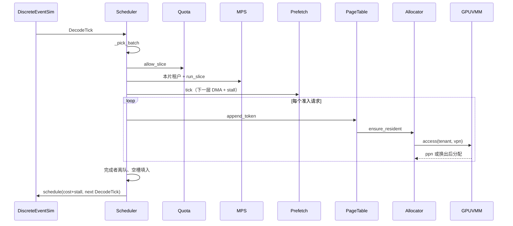
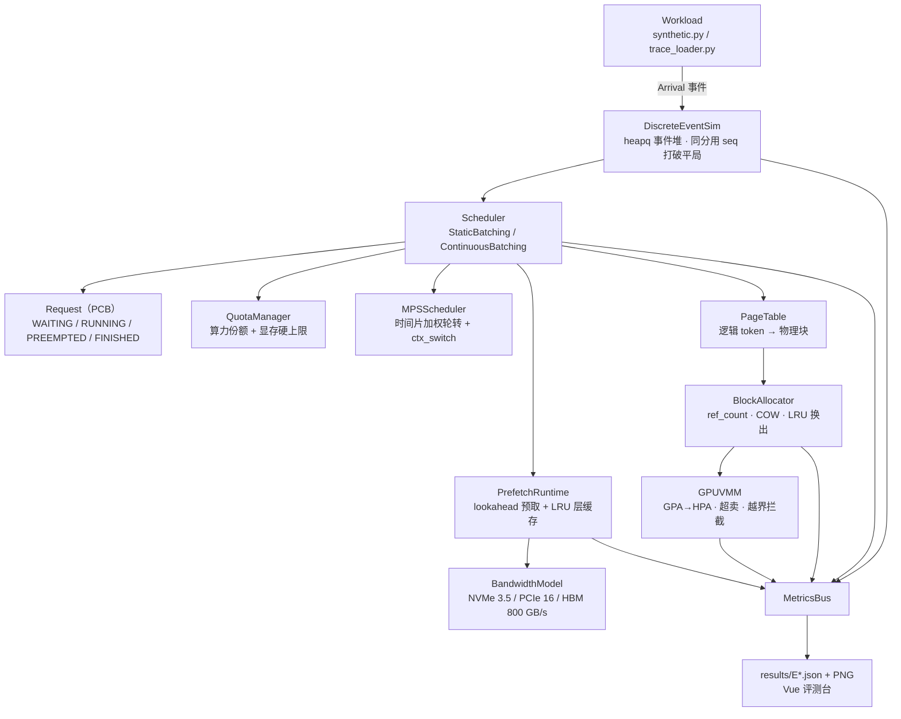
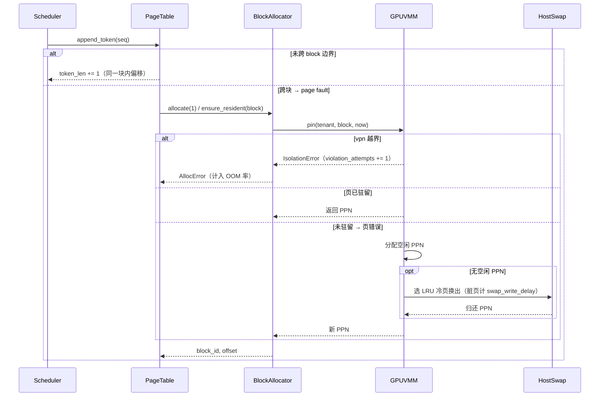

# 系统设计文档

**项目：** llmOS（面向大模型推理优化的操作系统级任务）  
**实现方式：** 个人独立完成；仿真为主交付。真实模型方向对照（G1）已在本地 RTX 5060 + Qwen2.5-0.5B 完成，见 §7；云端 Colab T4 背书为可选后续。

## 1 OS 映射

| OS 子系统 | 模块 | 请求路径中的位置 |
| --- | --- | --- |
| 进程调度 | `ContinuousBatchingScheduler` / `StaticBatchingScheduler` | `_decode_tick` 内选本片 batch |
| 资源管理 | `QuotaManager` + `MPSScheduler` | 显存硬上限、本片可运行租户 |
| I/O | `PrefetchRuntime` | `tick(sim)` 发 DMA，stall 计入本片 cost |
| 虚拟内存 | `GPUVMM` | GPA→HPA，超卖与越界拦截 |
| 分页 | `PageTable` + `BlockAllocator` | `append_token` → `ensure_resident` → `VMM.access` |

## 2 全路径时序（一次 decode）



预取不占用真实线程：完成时刻入事件堆，`kind=DmaComplete`。stall 只计「计算等到数据就绪」。

## 3 模块图（依赖方向单向向下）



依赖只允许自上而下：调度器不 import `GPUVMM` / `BandwidthModel`，VMM 不理解 token 语义，分配器不实现时间片。

## 4 页错误时序（append_token → 分配 → 可能 OOM）



分配器在联调模式下每块都经 `VMM.access`，因此任务一的 OOM 与任务四的超卖是同一资源池的两种视图，不存在两套账。

## 5 实现要点

- 时钟：`heapq`，同分用 `seq` 打破平局，内核无 `sleep`。
- 随机：仅 `random.Random(seed)` 生成负载。
- 配置：一律 `configs/default.yaml`，结果带 `config_digest`。
- 冻结接口：分配器 / 页表 / VMM / 调度器保持原方法名；扩展以可选参数追加（如 `vmm=`、`prefetch=`）。
- 明确不做：MLFQ、伙伴系统、ARC、vLLM 引擎对接；真实 GPU 只做非阻塞的方向背书（本地 G1 已完成，云端 Colab 可选）。

## 6 模块职责与禁止越权

调度器只编排，不实现别人的策略。

| 模块 | 允许 | 禁止（未越权） |
| --- | --- | --- |
| `DiscreteEventSim` | `now` + 事件堆 | 无选批、无分配 |
| `Scheduler` | 入队、选批、抢占、PCB 统计 | 不 import `GPUVMM` / `BandwidthModel` |
| `QuotaManager` | 份额、硬上限、`allow_slice` | 不决定谁先 decode |
| `PrefetchRuntime` | 重叠与 stall | 不改页表 |
| `GPUVMM` | 驻留、换出、balloon、越界 | 不懂 token |
| `PageTable` / `Allocator` | 映射、COW、碎片、向 VMM 要页 | 不实现时间片（在 MPS） |

`BlockAllocator.tenant` 在每个请求 `step` 前切换，供 VMM 按租户拦截。`experiments.py` 是评测总装，E7/E9/E10 可直接打预取/VMM/MPS。

## 7 真实 GPU 方向背书（G1 / G2，非阻塞）

**状态：** G1 已在本地 RTX 5060 + Qwen2.5-0.5B 完成（2026-11-16 复跑），方向与仿真 E1 一致；G2（vLLM 持续批）与 Colab T4 标准环境背书为可选后续。仿真评测仍以 `results/E*.json` 为准。

**原则：** 仿真（llmOS）是主交付；本节是零硬件清单里「真实 GPU + 推理框架」的预留方案，失败不阻塞答辩。GPU 脚本**不 import `llmos`**，产物只落 `gpu_results/`。

### 7.1 目标与非目标

| 仿真 | GPU 上希望看到的方向 |
| --- | --- |
| E1 连续预占 vs KV 分页 | 连续 KV 并发上不去或更易 OOM；分页引擎同显存可挂更多序列 |
| E4 静态批 vs 持续批 | 持续批吞吐更高，短请求 TTFT 更好 |

明确不做：不在 GPU 上复现预取、超卖/MIG/balloon；不追求与仿真数字一致；不上 7B 全精度。

### 7.2 选型

| 项 | 选择 | 原因 |
| --- | --- | --- |
| GPU | Google Colab T4 16GB（Kaggle 备选） | 免费；一张 `nvidia-smi` 即可交差 |
| 基线框架 | HuggingFace transformers | 默认连续 KV + 整批 `generate`，对应仿真 contiguous / 静态批 |
| 优化框架 | vLLM | PagedAttention + 持续批，对应任务一、二 |
| 不选 llama.cpp | — | 主线是量化与 CPU 卸载，对不上页表与 iteration 组批 |
| 模型 | `Qwen/Qwen2.5-0.5B-Instruct` | 8 GB 卡上两套引擎都能跑，避免显存噪声淹没结论 |

同一会话、同一模型、同一 prompt 列表、同一 `max_new_tokens`，只换引擎。

### 7.3 对照架构

```
合成 prompt 列表（与仿真 W1 同分布：prompt 32–128 token，生成 32–64）
        |
        +--> [A] transformers.generate   连续 KV，固定 batch
        |         指标：峰值显存、OOM 次数、整批墙钟吞吐、首 token 粗测
        |
        +--> [B] vLLM LLM.generate      PagedAttention + 持续批
                  指标：峰值显存、OOM 次数、req/s、TTFT
        |
        v
  只比较方向：B 的并发/吞吐不低于 A，OOM 不高于 A
  记录：GPU 名、驱动、CUDA、transformers/vLLM/torch 版本、模型、精度
```

### 7.4 实验设计

**G1（对应 E1，显存与并发）**：固定 fp16、`max_new_tokens=2048` 预占预算，并发序列数
N = 4…640；A 侧每条序列独立 `past_key_values` 并预留满长度（连续预占），B 侧按需增长
（分页代理）。主指标：成功完成的最大 N、是否 OOM、峰值显存。**通过线：** B 的最大 N ≥ A，或 A 先 OOM。

**G2（对应 E4，调度形态，可选）**：固定 N，一次性提交（静态批）vs 交错提交（持续批，
vLLM）；主指标墙钟吞吐与粗 TTFT；通过线 B 吞吐 ≥ A。

### 7.5 指标关系与禁止事项

| GPU 字段 | 仿真字段 | 关系 |
| --- | --- | --- |
| 峰值显存、最大 N、OOM | `kv_utilization_peak`、`peak_concurrency`、`oom_ratio` | 只比升降方向 |
| req/s、TTFT | `throughput`、`ttft_p50` | 只比升降方向 |
| — | `io_stall_ratio`、`oversubscription_ratio`、`fairness` | GPU 不做 |

**禁止**把 GPU 墙钟吞吐写进仿真 JSON 当同一列数字；主评测只引用 `results/E*.json`，GPU 数字进评测报告附录。

### 7.6 实测结果（2026-11-16，本地 RTX 5060 8 GB）

| 项 | 结果 |
| --- | --- |
| StaticCache（连续预占）最大并发 | **192**（7.715 GB，N=256 时超物理显存） |
| DynamicCache（按需）最大并发 | **640**（7.749 GB，仍在显存内） |
| 提升 | **×3.33**，verdict `CONSISTENT_WITH_SIM_E1` |
| prefill 拟合 | 2.48 ms + **0.122 ms/token**（R²=0.92），约为冻结 alpha 的 6× |
| decode 拟合 | 29.5 ms + **0.20 ms/批**（R²=0.39），kernel 发射地板主导 |
| 实测 KV | 12,288 B/token（24 层 ×2 KV 头 ×64 ×2 路 ×fp16），仿真块模型约 25× |

**WDDM 说明：** Windows 下超物理显存会回溢主机共享内存而不抛 CUDA OOM，故脚本以 `nvidia-smi`
物理显存 0.98× 为「装得下」阈值；Colab T4 为 compute mode，同一脚本走真实 OOM 分支。
0.5B 在 8 GB 上需把预占预算调到 2048 token/槽才能压出边界。

### 7.7 风险与兜底

| 风险 | 处理 |
| --- | --- |
| Colab 抢不到 T4 | 改 Kaggle；仍失败则附录注明，主文只保留仿真 |
| vLLM 与 CUDA 轮子不匹配 | 只交 G1 的 transformers 基线，结论降级为「连续 KV 基线已实测」 |
| 0.5B 太轻，E1 两边都不 OOM | 加大 `max_new_tokens` 或 N（本机已按此压出边界） |
| 数字与仿真差数量级 | 预期内：仿真是抽象 step_cost，GPU 是真实 kernel |

### 7.8 复跑方式

```powershell
python adapters\gpu_g1.py --model "D:\Python\data\Qwen2.5-0.5B"   # 本地
python adapters\gpu_g1.py --model Qwen/Qwen2.5-0.5B-Instruct      # Colab
```

产物：`gpu_results/g1.json`、`g1.png`、`calibration.json`、`calibration.png`、`nvidia-smi.txt`；
也可在评测台首页面板一键触发（子进程隔离运行，torch 不进 FastAPI 进程）。
